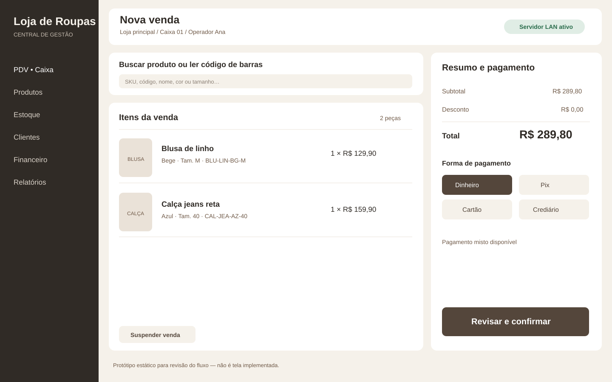

# D4 — Mockups vetoriais estáticos

Estes arquivos SVG, incluídos no repositório como documentação visual editável, mostram a direção boutique premium aprovada e dois fluxos críticos. São **protótipos estáticos de layout**, não telas funcionais nem protótipos navegáveis; não houve desenvolvimento do app.

## Desktop — PDV

**Aceite visual:** status da LAN, operador e caixa sempre visíveis; leitura de SKU prioritária; carrinho claro; total verificável; pagamentos múltiplos; confirmação distinta de suspensão.

## Mobile — inventário

**Aceite visual:** leitura de código e contagem acessíveis numa mão; divergência visível sem aplicar ajuste; aprovação segregada pelo gestor.

## Próximas revisões
1. Conferir contraste das cores de status e testes com leitores de tela.
2. Validar com um operador de caixa e um estoquista usando dados sintéticos.
3. Expandir o mesmo padrão para as 48 telas catalogadas; gerar protótipo navegável quando aprovado.
4. Manter estados de falha/erro e fluxos previstos em jornadas-e-wireframes.md.

Toda imagem é um **exemplo ilustrativo**, sem dados reais de cliente ou evidência de sistema implementado.
