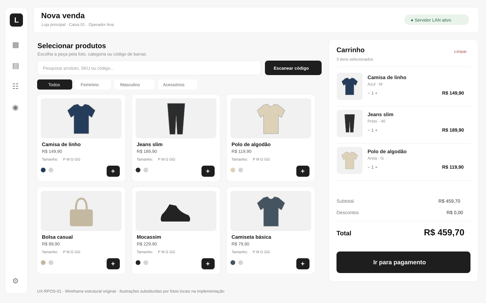
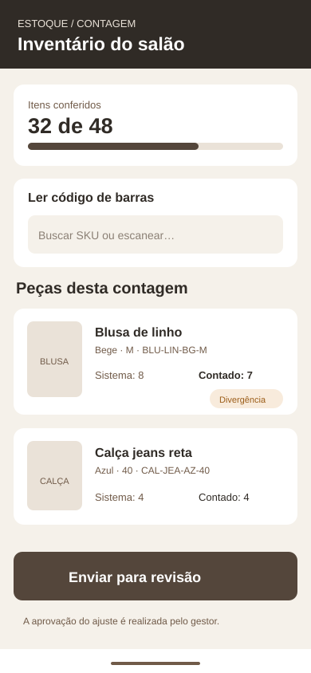

# D4 — Mockups estáticos e referência oficial

**Referência visual vigente do PDV:** [Retail Fashion POS — UX-RPOS-01](direcao-visual-retail-pos.md) (especificação aprovada como direção após as 65 decisões). A referência escolhida pelo gestor foi uma captura do conceito “Lunatics – Retail POS Dashboard”, com layout branco, catálogo fotográfico e carrinho lateral. Recriar os padrões funcionais de forma original e com recursos licenciados.

## PDV — nova direção visual

O SVG é **um wireframe editorial original** de apoio à especificação: thumbnails desenhadas apenas como placeholders de fotografias reais do catálogo. Não representa aplicativo pronto, não contém fotos de produtos reais nem é protótipo navegável. As composições finais de produto serão alimentadas pelo cadastro e imagens armazenadas localmente.

### Mockup anterior (obsoleto como referência do PDV)
[Versão histórica marrom/creme baseada em lista](prototipo-pdv-desktop.svg) — preservada para comparação, **não implementar como direção principal**.

## Mobile — inventário (continua válido no seu módulo)

O inventário segue acessível e orientado ao operador. O refinamento do catálogo visual de produtos também deve ser aplicado aos componentes compartilhados quando pertinente, sem forçar o layout do PDV em todas as telas.

## Critérios de revisão
1. PDV >=1280px: rail estreito, 3 colunas de produtos com fotos, categoria e seleção de variante, carrinho visível, pagamento separado e sem rolagem horizontal.
2. Mobile: 1/2 colunas por breakpoint legível, resumo visível e carrinho acessível em drawer.
3. Contraste, foco e teclado, scanner, leitura de imagens fallback e estados de erro devem estar previstos.
4. O backend mantém dados canônicos; UI não estima disponibilidade como fato.
5. Protótipos visuais finais e navegáveis são entregas de homologação D4 antes de implementar componentes.

**Status:** documentação e artefato vetorial ilustrativo; nenhuma aplicação implementada.
